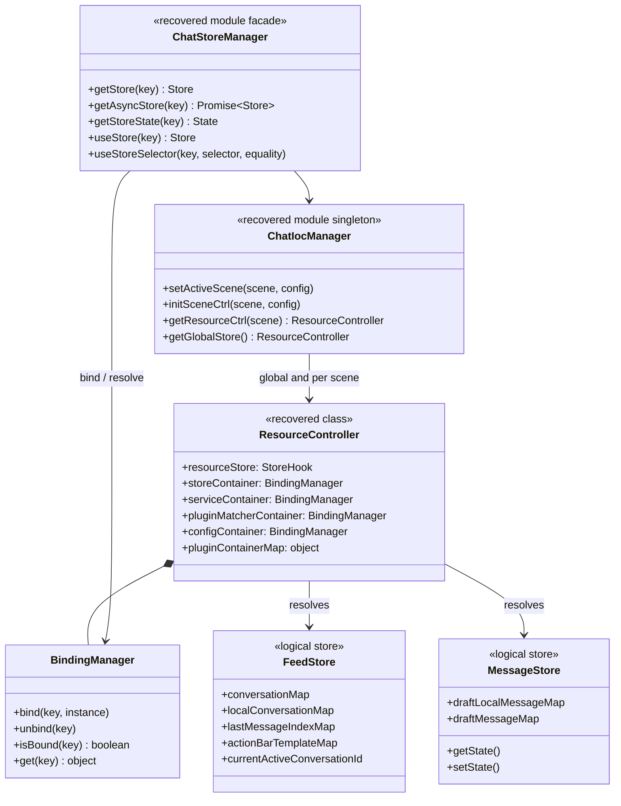

# Runtime, IoC, and stores

## Evidence

Primary recovered modules: `chat/chat-ioc-manager.js`, `chat/chat-store-manager.js`, `chat/chat-feed-store-factory.js`, and `chat/chat-message-store-factory.js`.

## Class diagram

## Detailed behavior

`ResourceController` separates lazy store resources, instantiated stores, services, plugin matchers, and configuration into distinct registries. Preserve that separation: a store can be loaded later while a service is immediately available.

`ChatStoreManager.getStore` rejects an async store loader; callers must use `getAsyncStore`. Both instantiate the resolved factory once and cache it in `storeContainer`. This is a real invariant, not a convenience API.

The default active scene is `PC_MAIN_BOT_WEB`. Core registered store keys include `chatMessageStore`, `samanthaChatProtocolStore`, `chatInputStore`, `attachmentsStore`, `attachmentUploadStore`, `refContentStore`, and `skillStore`.
