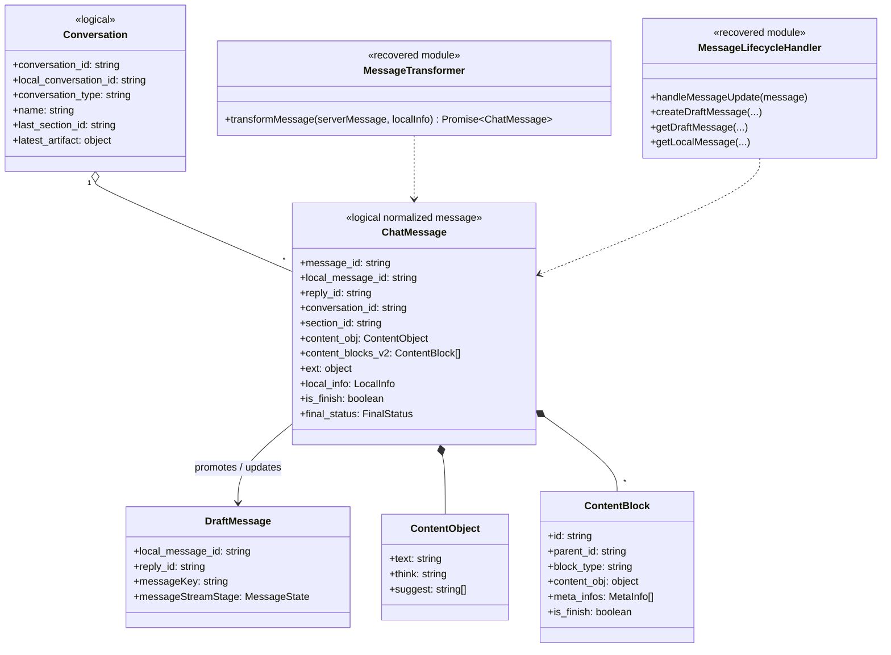

# Chat domain and message lifecycle

## Evidence

Primary recovered modules: `chat/chat-message-transformer.js`, `webpack-bundle-runtime-chunks/message-lifecycle-handler.js`, and `chat/chat-conversation-update-handler.js`.

## Class diagram

## `transformMessage` detail

It parses wire `content`, derives conversation and bot identity, converts `ext` into completion/regeneration/suggestion/security fields, derives a flat block collection and a parent-child block tree, parses async-task and thinking data, then delegates to a matching skill-specific transformer when one exists. The default result removes bulky wire-only content fields before storage.

## `handleMessageUpdate` detail

The router recognizes ACK/send updates, loading chunks, suggestion messages, and final received messages. It compares chunk sequence values before merging, so an old stream event cannot overwrite newer content. ACK promotes a local draft to a server-correlated message and creates the reply draft that receives the stream.

**Recovery rule:** keep `local_message_id` and `message_id` distinct. The first powers optimistic UI, retries, and stream correlation; the second is assigned by the server.
