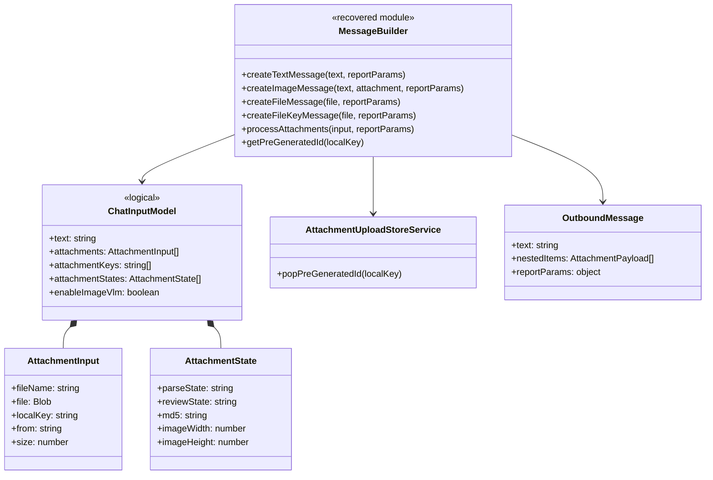

# Input and attachments

## Evidence

Primary recovered module: `async-business-input-engine-submit/chat-message-builders.js`.

## Class diagram

## `processAttachments` detail

The builder joins attachment descriptors, remote upload keys, and attachment states by array index. It excludes links/Lark documents; gives remote files a generated UUID and local files their local key; carries parse/review state and MD5; and encodes images as image resources only if VLM is enabled. Images retain their original dimensions.

The parallel-array design is fragile. Any reconstruction should use a key-based map or validate matching lengths. Do not submit before the upload key exists: several `wait-for-attachment-upload-key` modules explicitly enforce that boundary.
