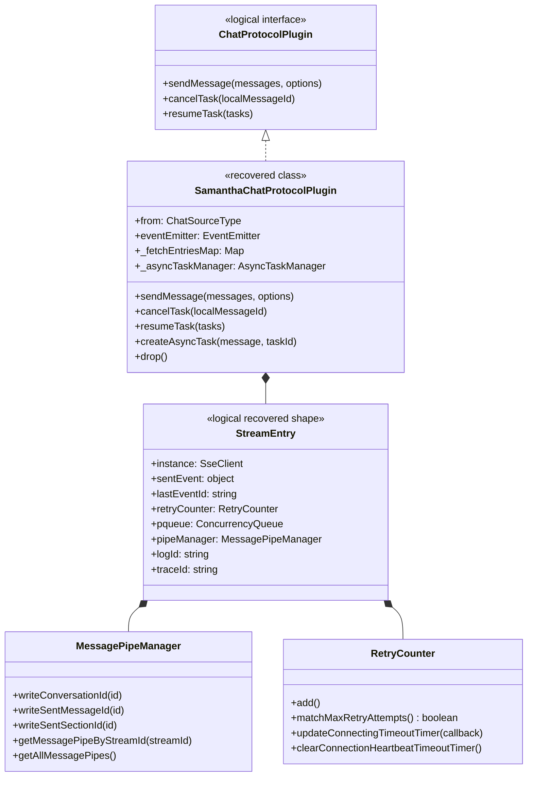
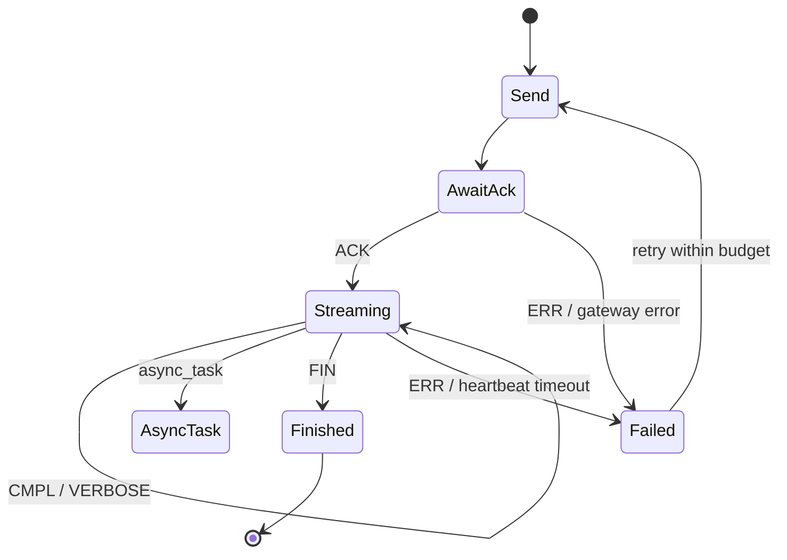

# SSE protocol and asynchronous tasks

## Evidence

Primary recovered module: `async-infra-message-alice/alice-chat-stream-protocol-plugin.js`.

## Class diagram

## Confirmed contract and flow

The plugin sends `POST /samantha/chat/completion` with same-origin credentials and expects `text/event-stream`. It keeps the last received event ID, validates the SSE response type, extracts `x-tt-logid` and `x-tt-trace-id`, and uses a one-concurrency queue to preserve chunk order.

Visible event types are `ACK`, `CMPL`, `FIN`, `VERBOSE`, `ERR`, and `VERSION`. Preserve ordered processing, last-event checkpointing, and the no-retry cases for cancellation, diff-stage requests, and exhausted retry budget.
