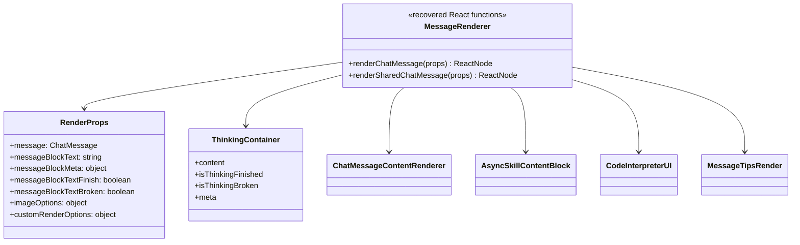

# Message rendering and artifacts

## Evidence

Primary recovered module: `async-infra-message/chat-message-renderer.js`.

## Class diagram

## Detailed behavior

The normal renderer can show thinking and ordinary message content concurrently. Thinking visibility is governed by message status and `think_reason_is_hide`; broken thinking is handled separately. It derives code-interpreter configuration and custom slots from the message, then passes them to the content renderer.

The shared-message renderer uses `AsyncSkillContentBlock` and theme-specific receive styling. Risk tips render only for completed or terminal-error messages.

Artifacts must enter through normalized message blocks and dedicated extractors such as `extract-artifact-from-chat-message`; leaf components should not fetch or mutate artifact state directly.
