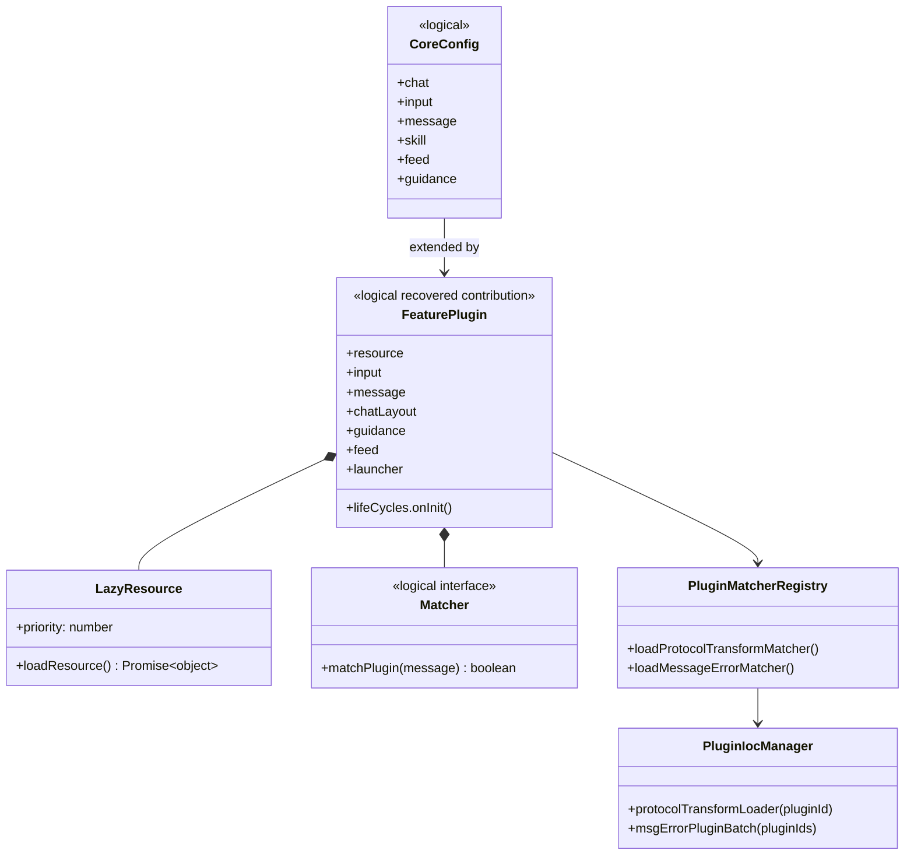

# Plugin and skill platform

## Evidence

Primary recovered module: `chat/chat-ioc-manager.js`; feature families: `ai-space-*`, `ai-search-*`, `ai-coding-*`, `ai-ppt-*`, and `async-*`.

## Class diagram

## Detailed behavior

The IoC manager merges feature plugin resources and matcher contributions into the active scene. Resources can carry priority and are wrapped in async memoization/on-demand loaders. A plugin can also execute `lifeCycles.onInit`.

For protocol transforms, the message transformer asks the matcher registry for the first matching plugin and loads it through `PluginIocManager`. A plugin exposing `aliceChatMessageToMessage` owns the final feature-specific mapping. This isolates special wire contracts from common chat code.

The main observed feature families are AI Space (drive/file context), Search, Coding, PPT, document/canvas, media, and spreadsheet/code-interpreter flows.
