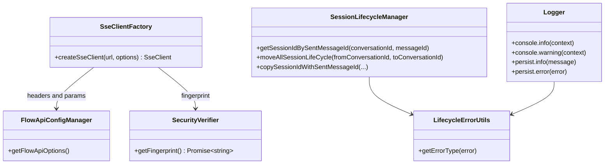

# Cross-cutting services and boundaries

## Evidence

Recovered references in the SSE plugin and lifecycle handler include `flow-api-config-manager`, `sse-client-factory`, `security-verify-sdk-loader`, logger services, event reporters, and the session lifecycle manager.

## Class diagram

## Detailed behavior

The completion client reads common headers/parameters from the API config manager, adds a browser fingerprint, uses same-origin credentials, validates the response media type, and preserves log/trace IDs for error reporting.

Errors have two destinations: the message/session lifecycle must reach a terminal state, and observability receives context. A generic UI toast is insufficient because retries, rendering, and analytics depend on the message-store error update.

This frontend proves fingerprinting and URL sanitization use in message construction. It does not prove server authorization, storage encryption, scanning, or model-side safety enforcement.
