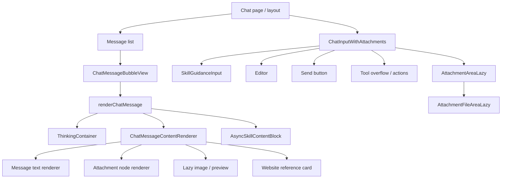
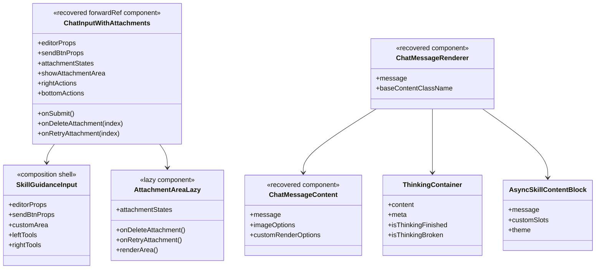
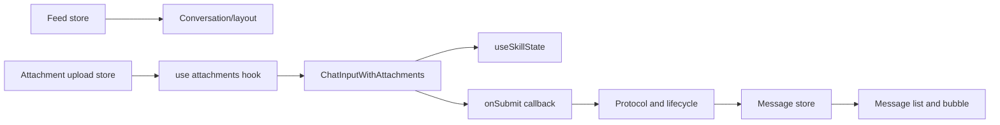
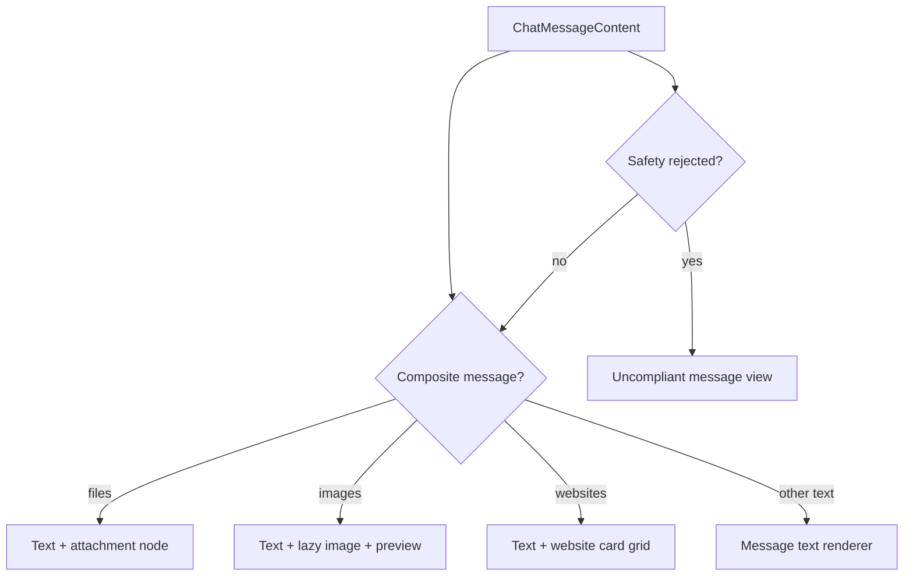

# React component design

## Evidence and scope

This design is recovered from `chat-input-ui/chat-input-with-attachments-component.js`, `chat-input-attachment-area/chat-input-attachment-area-component.js`, `async-infra-message/chat-message-bubble-view.js`, `chat-message-components/chat-message-content-renderer.js`, and `async-infra-message/chat-message-renderer.js`.

These are React function components and hooks, not class components. The diagrams therefore model component contracts, composition, and state ownership rather than JavaScript inheritance.

## Top-level component hierarchy



## Component contract diagram



## State ownership



### Rule: stores own durable state; components own presentation state

- Durable data lives in chat, message, feed, and attachment-upload stores.
- `ChatInputWithAttachments` owns editor value through `useSkillState`, with controlled-value support from `editorProps`.
- Attachment hooks own the current attachment list but mirror preprocess/upload progress from `attachmentUploadStore`.
- Renderers receive a normalized message and derive display-only values through memoization/hook selectors.

This split is essential for streaming: a component must re-render from store updates rather than mutating a message object received in props.

## Input composition detail

`ChatInputWithAttachments` is the reusable input shell. It forwards a ref, normalizes controlled/uncontrolled editor data, disables sending when extracted text is empty or the caller sets `disableToSend`, and delegates keyboard semantics to `useChatInputSkillKeyHandler`.

It uses an extension-slot pattern for `bottomActions` and `rightActions`. Each contribution receives an editor tool context containing `type`, `isToolButtonSmall`, `getValue`, and `onUpdateValue`. Contributions are filtered, ordered, and rendered through a matcher utility. This is how skills add buttons without forking the input shell.

Attachment UI is lazy-loaded only when `showAttachmentArea` is true. Deletion and retry actions travel upward through callbacks; upload orchestration stays outside the visual component.

## Attachment hook detail

The recovered attachment hook inside the input module:

- subscribes to `attachmentUploadStore` to derive each attachment's key and state;
- creates direct attachments with a UUID local key and an already-complete preprocess task;
- asks `attachmentUploadStoreService.preprocessFile` to create normal upload tasks;
- cancels preprocessing on deletion and may delete remote uploaded files;
- resets the pre-generated local-message ID when the attachment list becomes empty;
- invokes `reUpload` with the active conversation bot ID for retry.

The component should expose these as actions, not duplicate them. In particular, local keys are the identity that ties an input chip to its upload progress.

## Message-rendering decision tree

`ChatMessageContent` selects a rendering mode from the normalized message:



File blocks include parse/read status, character count, and read ratio. Images use sanitized URLs, a preview-event hook, and resend behavior where appropriate. Website cards only open approved HTTPS URLs and sanitize icon URLs. Those checks belong at render boundaries because the message payload is server-derived.

## Thinking and skill blocks

`renderChatMessage` may render both `ThinkingContainer` and ordinary message content. The thinking UI receives metadata, completion/broken flags, and identity fields for analytics. The normal route uses `ChatMessageContentRenderer`; the shared route uses `AsyncSkillContentBlock` plus theme data and custom slots.

The recommended reconstruction boundary is:

```text
message store -> bubble/list component -> orchestration renderer -> typed content block component
```

Do not make the top-level message list branch directly on every skill or content subtype; add a typed block renderer or plugin slot instead.

## Implementation guidance for another agent

1. Build store selectors before leaf components; all visual components should accept stable, normalized props.
2. Keep the input shell generic and add feature controls through the existing action-slot contract.
3. Keep upload state and cleanup in a hook/service; keep attachment chips presentational.
4. Preserve lazy boundaries around expensive attachment/media/rendering components.
5. Sanitize every server-originated URL at the image/link/window-open boundary.
6. Treat thinking, ordinary content, artifacts, and risk status as independently renderable subregions of one message.
