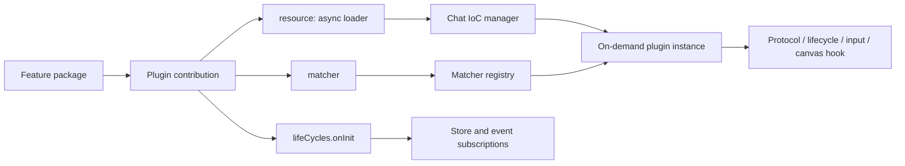
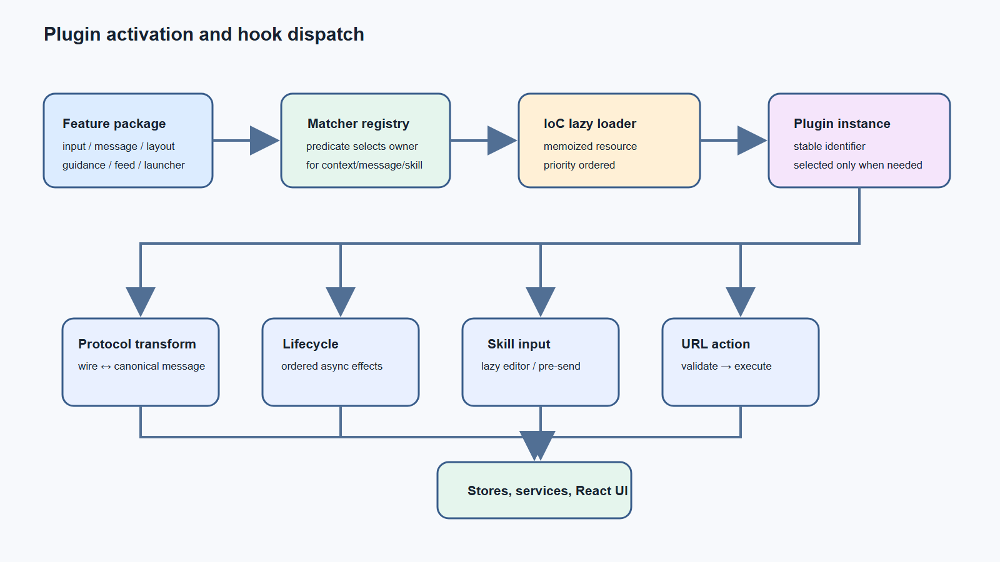

# Plugin catalog and activation model

## Scope and evidence

This inventory covers **product extension packages**, not every third-party library whose name includes `plugin`. It is derived from recovered chunk directories and the core composition code in `chat/chat-ioc-manager.js` and `chat-plugins-runtime/chat-plugin-getter-utils.js`.

The exact byte-preserved recovery is in `spec/readable-source`; the practical entry points are in [11-plugin-source-recovery.md](11-plugin-source-recovery.md).

## Runtime model

`ChatIocManager` merges `core` services/stores with each feature contribution. Contributions are grouped into `input`, `message`, `chatLayout`, `guidance`, `feed`, and `launcher`. A contribution can provide a matcher and lazy resource loader; resources with `priority` are sorted before loading. A bundled package therefore runs only when its matcher selects it in the active scene/message.

## Canonical extension contracts

| Contract | Selection | Purpose | Examples |
|---|---|---|---|
| URL pre-parser | navigation/action matcher | validate and normalize before a side effect | `*-url-parse-pre-plugin` |
| URL parser/action | navigation/action matcher | create/open an AI Space action | `ai-space-*-url-parse-plugin` |
| Chat input | input matcher / skill selection | editor, tools, validation, pre-send | `async-skill-chat-input` |
| Protocol transform | message protocol matcher | wire message ↔ canonical message | `async-skill-message-protocol-transform` |
| Message lifecycle | lifecycle matcher | ordered effects around message updates | `async-skill-message-lifecycle` |
| Block renderer | block matcher | render or merge feature content blocks | requirement/markdown packages |
| Canvas/layout | canvas matcher | open/control workspaces and artifacts | coding/document/image canvas packages |
| Guidance/skill bar | guidance/input matcher | capability discovery and onboarding | `*-skill-guidance-page`, `*-skill-bar` |

## Complete package catalog

### AI Space URL and artifact actions

| Packages | Capability |
|---|---|
| `ai-space-coding-url-parse-pre-plugin`, `ai-space-coding-url-parse-plugin` | validate/open coding-space URLs |
| `ai-space-doccanvasopenurl-url-parse-plugin` | open document-canvas URLs; artifact extraction and skill registry |
| `ai-space-excelairead-url-parse-pre-plugin`, `ai-space-excelairead-url-parse-plugin` | Excel AI-read actions |
| `ai-space-excelcodeinter-url-parse-pre-plugin`, `ai-space-excelcodeinter-url-parse-plugin` | spreadsheet Code Interpreter actions |
| `ai-space-fileairead-url-parse-pre-plugin`, `ai-space-fileairead-url-parse-plugin` | file AI-read actions |
| `ai-space-fileaskdoubao-url-parse-pre-plugin`, `ai-space-fileaskdoubao-url-parse-plugin` | Ask Doubao file actions |
| `ai-space-imageaskdoubao-url-parse-plugin` | image question flows |
| `ai-space-imagecreate-url-parse-pre-plugin`, `ai-space-imagecreate-url-parse-plugin` | image-generation request validation/building |
| `ai-space-imageedit-url-parse-pre-plugin`, `ai-space-imageedit-url-parse-plugin`, `ai-space-imageeditoraction-url-parse-plugin` | input resolution, image edit, editor actions |
| `ai-space-linkairead-url-parse-pre-plugin`, `ai-space-linkairead-url-parse-plugin` | link AI-read actions |
| `ai-space-linkaskdoubao-url-parse-pre-plugin`, `ai-space-linkaskdoubao-url-parse-plugin` | Ask Doubao link actions |
| `ai-space-mediaread-url-parse-pre-plugin`, `ai-space-mediaread-url-parse-plugin` | media-read URLs |
| `ai-space-minutes-metting-parse-pre-plugin`, `ai-space-minutemetting-url-parse-plugin` | meeting-minute actions |
| `ai-space-wordfileread-url-parse-pre-plugin`, `ai-space-wordfileread-url-parse-plugin` | Word-file reading |
| `auto-switch-ppt-skill-url-parse-plugin`, `code-artifacts-url-action-plugin`, `image-canvas-openurl-url-parse-plugin`, `read-pdf-latest-reading-url-parse-plugin`, `super-task-duplicate-url-parse-plugin`, `vip-feature-url-parse-plugin` | specialist action adapters |

### Skill input, guidance, and feature UI

| Packages | Capability |
|---|---|
| `academic-search-skill-chat-input`, `academic-search-skill-guidance-page` | academic search |
| `ai-search-skill-chat-input`, `search-skill-guidance-page`, `search-skill-guidance-page-v2` | web/search |
| `coding-skill-chat-input`, `coding-skill-guidance-page`, `coding-skill-store`, `code-interpreter-skill-guidance-page` | coding and Code Interpreter |
| `deep-search-skill-chat-input`, `deep-search-skill-guidance-page` | deep research/search |
| `image-skill-chat-input`, `image-skill-guidance-page` | image creation |
| `music-skill-chat-input`, `music-skill-guidance-page` | music generation |
| `ppt-skill-chat-input`, `ppt-skill-guidance-page` | PPT creation |
| `translate-skill-chat-input`, `translate-skill-guidance-page` | translation |
| `video-skill-chat-input`, `video-skill-guidance-page` | video creation |
| `writing-skill-chat-input`, `write-skill-guidance-page`, `writing-skills-carousel-ui` | writing |
| `exercise-skill-chat-input`, `read-website-skill-guidance-page`, `read-pdf-skill-guidance-page-v2` | specialist exercise/reading |
| `async-business-skill-bar`, `async-business-skill-bar-matcher`, `sync-business-skill-bar`, `ondemand-skill-bar`, `ondemand-recommand-skill`, `async-skill-bar-item` | discover, match, rank, render skills |
| `skill-pin-modal`, `async-skill-guidance`, `async-skill-guidance-card`, `async-skill-guidance-input`, `async-skill-guidance-suggestions` | pinning and recommendations |

### Chat runtime, messages, rendering

| Packages | Capability |
|---|---|
| `chat-plugins-runtime`, `chat-plugin-registry` | lazy loader/matcher gateway |
| `async-skill-chat-input` | primary skill-input runtime: CI, coding, deep search, image, music, PPT, read URL/doc, translate, video, writing, generic |
| `async-skill-message-protocol-transform`, `async-skill-message-protocol-transform-matcher` | transform search, code, doc, PPT, media, image, music, translate, write, UGC, super-task messages |
| `async-skill-message-lifecycle`, `async-skill-message-list-lifecycle` | attachment/task/artifact/document/code/PPT/image/music/podcast/deep-research/credit lifecycle effects |
| `async-skill-message-list`, `async-skill-message-list-matcher`, `async-skill-message-group`, `async-skill-message-cmd` | list assembly, grouping, matching, commands |
| `async-skill-receive-message-action`, `async-skill-receive-message-action-matcher`, `async-skill-send-message-action`, `async-skill-send-message-action-matcher`, `async-skill-share-receive-message-action`, `async-skill-write-receive-message-action` | action dispatch |
| `async-skill-receive-message-box`, `async-skill-receive-message-box-top`, `async-skill-receive-message-box-top-matcher`, `async-skill-receive-message-box-bottom`, `async-skill-receive-message-box-bottom-matcher`, `async-skill-send-message-box` | message-box chrome |
| `async-skill-content-block`, `async-skill-content-block-resolve`, `async-skill-content-block-merge`, `content-merge-plugin` | content-block resolution/merge |
| `artifact-op-block-plugin`, `artifact-op-plugin-matcher`, `file-operation-plugin-matcher`, `gen-image-plugin-matcher` | operation routing |
| `requirement-clarify-block-plugin`, `requirement-block-plugin-matcher`, `requirement-clarify-merge-plugin`, `requirement-clarify-plugin-matcher` | clarification rendering/merge |
| `async-markdown-common-meta-render-plugin`, `async-markdown-write-artifact-meta-render-plugin`, `async-markdown-slot-plugin-ci`, `async-markdown-slot-plugin-code-tools` | markdown metadata/slot rendering |
| `ai-ppt-skill-message`, `skill-message-box-plugin`, `ai-space-dialog-handlers` | skill message boxes/dialogs |

### Canvas, shell, and cross-cutting packages

| Packages | Capability |
|---|---|
| `ai-coding-open-canvas-repo-pre-plugin`, `ai-coding-open-canvas-repo-plugin`, `ai-coding-components` | coding canvas and repository context |
| `ai-ppt-slide-editor`, `ai-ppt-slides-component`, `ai-ppt-push-message-cmd`, `ppt-url-action-plugin` | PPT editor/deck/push command and URL action |
| `ai-doc-canvas-messaging` | document-canvas transport/loading |
| `async-skill-sidebar-application` | skill-driven sidebar shell |
| `login-chat-header-plugin`, `plugin-logout-matcher`, `user-logout-cmd-plugin` | header/session/logout |
| `safety-message-plugin` | safety message behavior |
| `module_extensions_text-toolbar-plugin` | text-toolbar extension |

## Rules shown by the source

- A plugin has a stable `pluginIdentifier`/symbol; matchers and loaders use it as the lookup key.
- Loader execution is on-demand and memoized. Put one-time effects in `lifeCycles.onInit` or a lifecycle plugin, not module top-level code.
- The first matching protocol transformer owns the message. Make matchers exclusive or order-aware.
- Protocol transforms should be deterministic; lifecycle hooks own stores, navigation, artifacts, subscriptions and toasts.
- `*-pre-plugin` packages validate/normalize before `*-plugin` packages perform actions.
