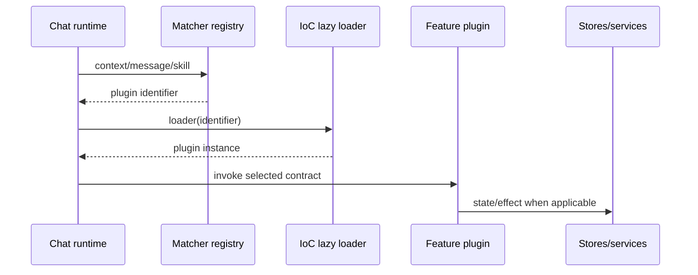

# Plugin hooks and extension points

## Hook dispatch



## Runtime gateway hooks

`chat-plugins-runtime/chat-plugin-getter-utils.js` is the narrow runtime facade. It exports these product extension points:

| Gateway | Matcher counterpart | Invocation | Output |
|---|---|---|---|
| `getChatCanvasPlugin` | `getChatCanvasPluginMatcher` | context → plugin | canvas/layout handler |
| `getChatMessageLifeCyclePlugin` | `getChatMessageLifeCyclePluginMatcher` | message/context → plugin | lifecycle handler |
| `getChatProtocolPlugin` | — | protocol identity → plugin | transport adapter |
| `getChatProtocolTransformPlugin` | `getChatProtocolTransformPluginMatcher` | wire message → plugin | canonical message transformer |
| `useChatSendMessageBoxPlugin` | `useChatSendMessageBoxPluginMatcher` | React render context → plugin | send-box UI extension |

The `get...` APIs retrieve on-demand loaders from the IoC manager. The matcher APIs retrieve predicates from the matcher registry. Matching therefore precedes and gates feature loading.

## Reconstructed contracts

### Configuration and initialization

```ts
type FeatureContribution = {
  input?: Record<string, { resource?: Resource; matcher?: Matcher }>;
  message?: Record<string, { resource?: Resource; matcher?: Matcher }>;
  chatLayout?: Record<string, { resource?: Resource; matcher?: Matcher }>;
  guidance?: Record<string, { resource?: Resource; matcher?: Matcher }>;
  feed?: Record<string, { resource?: Resource; matcher?: Matcher }>;
  launcher?: Record<string, { resource?: Resource; matcher?: Matcher }>;
  lifeCycles?: { onInit?(): void | Promise<void> };
};
type Resource = { priority?: number; loadResource(): Promise<object> };
type Matcher = (...args: unknown[]) => boolean | Promise<boolean>;
```

This shape comes from `chat/chat-ioc-manager.js`. Resources load in ascending priority; with no priority, declaration order is preserved. `onInit` runs only after the scene IoC containers are available and is the correct hook for one-time registration/subscriptions.

### Protocol transform

```ts
interface ChatProtocolTransformPlugin {
  pluginIdentifier: symbol | string;
  aliceChatMessageToMessage(wire: AliceMessage, context: unknown): ChatMessage;
  messageToSamanthaChatMessage(message: ChatMessage): SamanthaMessage;
}
```

`async-skill-message-protocol-transform/skill-message-protocol-transform.js` demonstrates this seam. The deep-research transformer serializes `content_obj.text`, optional `direct_research`, references, and the corresponding Samantha content type. Other transformers use the same contract for search, code, documents, PPT, media, image, music, translate, writing, UGC, and super-task payloads.

### Message lifecycle

```ts
interface MessageLifecyclePlugin {
  pluginIdentifier: symbol | string;
  processMessageBefore?(context: unknown, message: ChatMessage): Promise<ChatMessage>;
  processMessageAfter?(context: unknown, message: ChatMessage): Promise<ChatMessage>;
  dispose?(): void;
}
```

The recovered `ReadDocumentMessageLifeCyclePlugin` executes registered `processMessageBefore` handlers sequentially, awaits each, and feeds its result to the next handler. Lifecycles own attachment/task state, toasts, canvas/artifact opening, navigation and cleanup. A matcher must scope a lifecycle to its target messages.

### Chat input

The Code Interpreter entry in `async-skill-chat-input/async-skill-chat-input-plugin.js` extends a `SkillDefinition`. It carries `skillType`, static `pluginName`, an imperative service, and a lazy React `render` implementation:

```ts
interface SkillInputPlugin {
  pluginName: string;
  skillType: SkillType;
  render(props: SkillInputProps): React.ReactNode;
  preloadChunks?(): void;
  service?: { focusOnEditor(); updateEditorValue(value: unknown); clearEditorValue() };
}
```

It lazy-loads the editor under `Suspense`, forwards `onBeforeSendMessage` with `clearRefContent: false`, and retains focus/value control through the service. This keeps heavy editors out of the base bundle.

### URL pre-parser and action

URL packages form a two-stage hook:

1. `*-pre-plugin` validates URL/arguments, conversation access, and any required context; it returns normalized data or rejects.
2. `*-plugin` uses that normalized data to call Alice/chat services, create a message/action, or open an artifact/canvas.

No side-effectful service call should occur if the pre-parser rejects. Preserve validated conversation IDs rather than accepting a URL-provided ID at face value.

### Block, markdown, and message-box hooks

Block plug-ins own fragment rendering/merge semantics; a matcher selects by metadata/type. Markdown-slot and meta-render plug-ins participate while composing markdown. Message-box plug-ins add controls above/below received messages or the send box. Return UI/data from these hooks and keep mutations in commands/services.

## Ordering and errors

| Phase | Ordering | Failure behavior |
|---|---|---|
| Resource load | priority ascending, then declaration order | fail only selected capability |
| Protocol transform | first matching transformer | preserve raw/canonical fallback |
| `processMessageBefore` | sequential and awaited | stop partial commit; surface feature error |
| UI render | lazy + Suspense/error boundary | placeholder and retry chunk load |
| URL pre-parser → action | validation first | do not dispatch action on rejection |

## Implementer checklist

- Use a unique stable identifier and narrow, deterministic matcher.
- Lazy-load heavy code through `loadResource` or React lazy boundaries.
- Keep transforms pure; lifecycle hooks carry effects.
- Release subscriptions in `dispose`/cleanup.
- Validate untrusted URL/message data before calling services.
- Ensure optional plugin errors cannot break the base feed.
